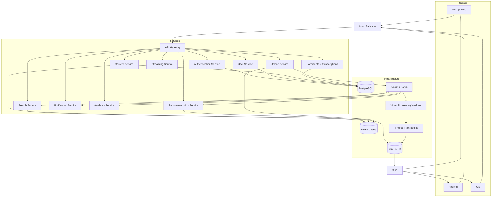
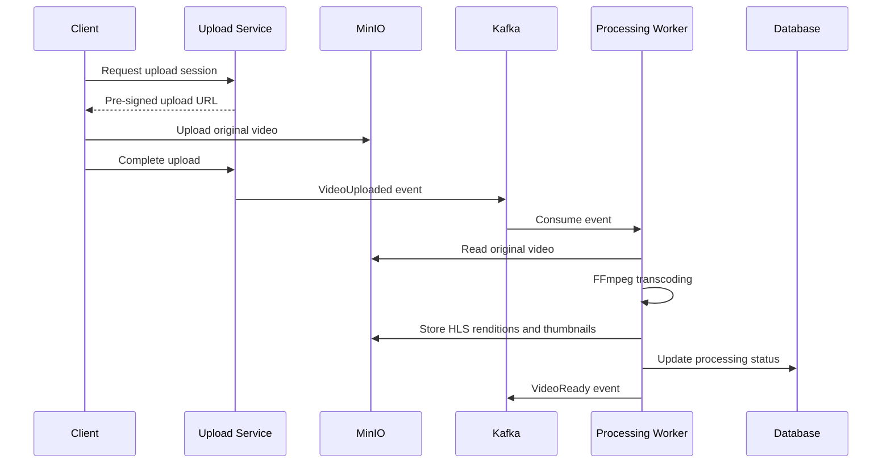

# Streamly

A YouTube-inspired video streaming platform built with TypeScript, Node.js, and a microservices architecture.

## Architecture



## Technology Stack

| Component | Technology |
|---|---|
| Web | Next.js, React, TypeScript |
| Backend | Node.js, TypeScript |
| Runtime & Tooling | Bun |
| API Gateway | NestJS or a dedicated gateway |
| Primary Database | PostgreSQL |
| Cache | Redis |
| Message Broker | Apache Kafka |
| Object Storage | MinIO / S3 |
| Video Processing | FFmpeg |
| Streaming Protocol | HLS |
| Search | OpenSearch |
| Recommendations | Python, scikit-learn |
| Containers | Docker, Docker Compose |
| Orchestration | Kubernetes |
| Monitoring | Prometheus, Grafana |
| Observability | OpenTelemetry |
| CI/CD | GitHub Actions |

## Services

| Service | Responsibility |
|---|---|
| API Gateway | Routing, rate limiting, request validation |
| Authentication | Login, registration, sessions, tokens |
| User | Profiles, channels, account preferences |
| Content | Video metadata, visibility, publication |
| Upload | Upload sessions, pre-signed URLs, validation |
| Streaming | Playback authorization and manifest resolution |
| Video Processing | Transcoding, HLS generation, thumbnails |
| Search | Full-text search and filtering |
| Social | Comments, reactions, subscriptions |
| Recommendation | Personalized feeds and related videos |
| Notification | In-app and subscription notifications |
| Analytics | Impressions, watch time, engagement events |

## Video Processing Pipeline



## Storage

**PostgreSQL**
- Users and profiles
- Video metadata
- Comments and reactions
- Channel subscriptions
- Watch history
- Notifications

**Redis**
- Video metadata cache
- Home-feed cache
- Rate-limit counters
- Frequently accessed data

**MinIO / S3**
```text
media/
├── originals/{videoId}/
├── hls/{videoId}/
│   ├── master.m3u8
│   ├── 360p/
│   ├── 720p/
│   └── 1080p/
└── thumbnails/{videoId}/
```

**Kafka Events**
- `video.uploaded`
- `video.processing.started`
- `video.processing.completed`
- `video.processing.failed`
- `video.published`
- `video.viewed`
- `video.liked`
- `channel.subscribed`

## Recommendation Pipeline

```mermaid
flowchart LR
    EVENTS[User Interaction Events] --> KAFKA[Kafka]
    KAFKA --> CONSUMER[Event Consumer]
    CONSUMER --> FEATURES[User & Video Features]
    FEATURES --> CANDIDATES[Candidate Generation]
    CANDIDATES --> RANKER[Ranking Engine]
    RANKER --> FILTER[Eligibility & Diversity Filters]
    FILTER --> FEED[Personalized Feed API]
    FEED --> CLIENT[Web & Mobile]
```



Initial ranking uses watch history, category affinity, recency, and engagement. Machine-learning-based candidate generation and ranking can be introduced later.

## Repository Structure

```text
streamly/
├── apps/
│   ├── web/
│   └── admin/
├── services/
│   ├── api-gateway/
│   ├── auth-service/
│   ├── user-service/
│   ├── content-service/
│   ├── upload-service/
│   ├── streaming-service/
│   ├── video-processing-service/
│   ├── search-service/
│   ├── social-service/
│   ├── recommendation-service/
│   ├── notification-service/
│   └── analytics-service/
├── packages/
│   ├── contracts/
│   ├── api-client/
│   ├── config/
│   ├── logger/
│   ├── validation/
│   └── ui/
├── infrastructure/
│   ├── compose/
│   ├── kafka/
│   ├── postgres/
│   ├── redis/
│   ├── minio/
│   ├── opensearch/
│   └── monitoring/
├── ml/
│   └── recommendation/
├── docs/
│   └── architecture/
├── docker-compose.yml
├── package.json
└── README.md
```