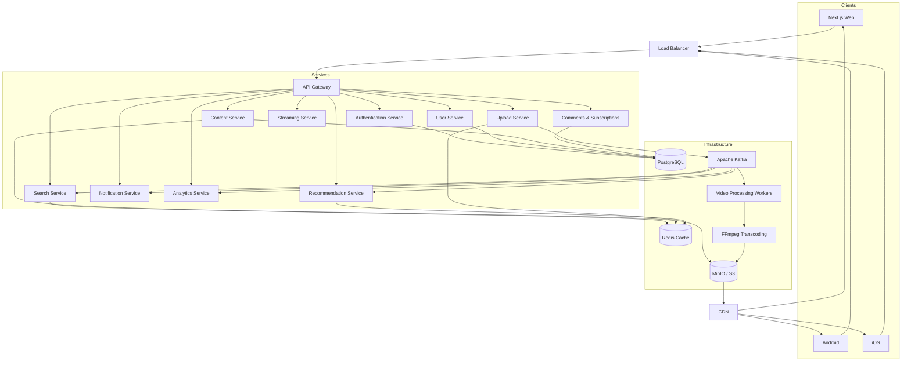
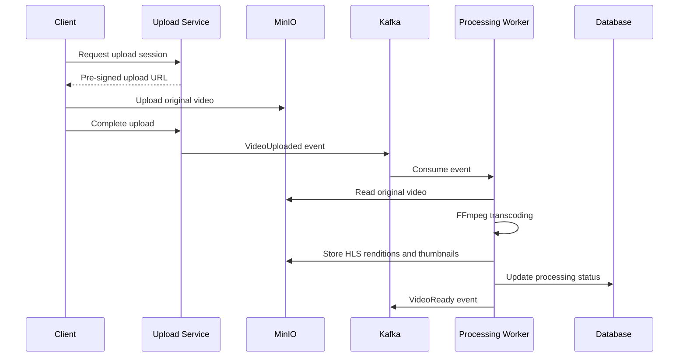

# Streamly

A YouTube-inspired video streaming platform built with TypeScript, Node.js, and a microservices architecture.

## Architecture



## Technology Stack

| Component | Technology |
|---|---|
| Web | Next.js, React, TypeScript |
| Backend | Node.js, TypeScript |
| Runtime & Tooling | Bun |
| API Gateway | NestJS or a dedicated gateway |
| Primary Database | PostgreSQL |
| Cache | Redis |
| Message Broker | Apache Kafka |
| Object Storage | MinIO / S3 |
| Video Processing | FFmpeg |
| Streaming Protocol | HLS |
| Search | OpenSearch |
| Recommendations | Python, scikit-learn |
| Containers | Docker, Docker Compose |
| Orchestration | Kubernetes |
| Monitoring | Prometheus, Grafana |
| Observability | OpenTelemetry |
| CI/CD | GitHub Actions |

## Services

| Service | Responsibility |
|---|---|
| API Gateway | Routing, rate limiting, request validation |
| Authentication | Login, registration, sessions, tokens |
| User | Profiles, channels, account preferences |
| Content | Video metadata, visibility, publication |
| Upload | Upload sessions, pre-signed URLs, validation |
| Streaming | Playback authorization and manifest resolution |
| Video Processing | Transcoding, HLS generation, thumbnails |
| Search | Full-text search and filtering |
| Social | Comments, reactions, subscriptions |
| Recommendation | Personalized feeds and related videos |
| Notification | In-app and subscription notifications |
| Analytics | Impressions, watch time, engagement events |

## Video Processing Pipeline



## Storage

**PostgreSQL**
- Users and profiles
- Video metadata
- Comments and reactions
- Channel subscriptions
- Watch history
- Notifications

**Redis**
- Video metadata cache
- Home-feed cache
- Rate-limit counters
- Frequently accessed data

**MinIO / S3**
```text
media/
├── originals/{videoId}/
├── hls/{videoId}/
│   ├── master.m3u8
│   ├── 360p/
│   ├── 720p/
│   └── 1080p/
└── thumbnails/{videoId}/
```

**Kafka Events**
- `video.uploaded`
- `video.processing.started`
- `video.processing.completed`
- `video.processing.failed`
- `video.published`
- `video.viewed`
- `video.liked`
- `channel.subscribed`

## Recommendation Pipeline

```mermaid
flowchart LR
    EVENTS[User Interaction Events] --> KAFKA[Kafka]
    KAFKA --> CONSUMER[Event Consumer]
    CONSUMER --> FEATURES[User & Video Features]
    FEATURES --> CANDIDATES[Candidate Generation]
    CANDIDATES --> RANKER[Ranking Engine]
    RANKER --> FILTER[Eligibility & Diversity Filters]
    FILTER --> FEED[Personalized Feed API]
    FEED --> CLIENT[Web & Mobile]
```



Initial ranking uses watch history, category affinity, recency, and engagement. Machine-learning-based candidate generation and ranking can be introduced later.

## Repository Structure

```text
streamly/
│
├── apps/                                  # Client applications
│   │
│   ├── web/                               # Next.js web application
│   │   ├── public/
│   │   │   ├── images/
│   │   │   ├── icons/
│   │   │   └── fonts/
│   │   ├── src/
│   │   │   ├── app/
│   │   │   │   ├── (auth)/
│   │   │   │   │   ├── login/
│   │   │   │   │   ├── register/
│   │   │   │   │   └── layout.tsx
│   │   │   │   ├── (main)/
│   │   │   │   │   ├── page.tsx          # Home feed
│   │   │   │   │   ├── watch/[videoId]/
│   │   │   │   │   ├── search/
│   │   │   │   │   ├── shorts/            # Optional future feature
│   │   │   │   │   ├── subscriptions/
│   │   │   │   │   ├── history/
│   │   │   │   │   └── layout.tsx
│   │   │   │   ├── channel/[channelId]/
│   │   │   │   ├── studio/
│   │   │   │   │   ├── videos/
│   │   │   │   │   ├── upload/
│   │   │   │   │   └── analytics/
│   │   │   │   ├── settings/
│   │   │   │   ├── layout.tsx
│   │   │   │   ├── globals.css
│   │   │   │   └── providers.tsx
│   │   │   ├── components/
│   │   │   │   ├── layout/
│   │   │   │   ├── navigation/
│   │   │   │   ├── video/
│   │   │   │   ├── player/
│   │   │   │   ├── feed/
│   │   │   │   └── common/
│   │   │   ├── features/
│   │   │   │   ├── auth/
│   │   │   │   ├── upload/
│   │   │   │   ├── playback/
│   │   │   │   ├── comments/
│   │   │   │   └── subscriptions/
│   │   │   ├── hooks/
│   │   │   ├── lib/
│   │   │   └── middleware.ts
│   │   ├── tests/
│   │   ├── next.config.ts
│   │   ├── package.json
│   │   └── tsconfig.json
│   │
│   ├── mobile/                            # React Native / Expo
│   │   ├── app/
│   │   │   ├── (auth)/
│   │   │   ├── (tabs)/
│   │   │   ├── watch/[videoId].tsx
│   │   │   ├── channel/[channelId].tsx
│   │   │   └── _layout.tsx
│   │   ├── src/
│   │   │   ├── components/
│   │   │   ├── features/
│   │   │   ├── hooks/
│   │   │   ├── lib/
│   │   │   └── player/
│   │   ├── assets/
│   │   ├── app.json
│   │   └── package.json
│   │
│   └── admin/                             # Internal administration UI
│       ├── src/
│       │   ├── app/
│       │   ├── components/
│       │   └── features/
│       └── package.json
│
├── services/                              # Backend microservices
│   │
│   ├── api-gateway/
│   │   ├── src/
│   │   │   ├── routes/
│   │   │   ├── middleware/
│   │   │   ├── guards/
│   │   │   ├── plugins/
│   │   │   ├── config/
│   │   │   ├── app.ts
│   │   │   └── server.ts
│   │   ├── tests/
│   │   ├── Dockerfile
│   │   └── package.json
│   │
│   ├── auth-service/
│   │   ├── src/
│   │   │   ├── modules/
│   │   │   │   ├── registration/
│   │   │   │   ├── login/
│   │   │   │   ├── sessions/
│   │   │   │   ├── tokens/
│   │   │   │   └── password-reset/
│   │   │   ├── middleware/
│   │   │   ├── config/
│   │   │   ├── app.ts
│   │   │   └── server.ts
│   │   ├── migrations/
│   │   ├── tests/
│   │   ├── Dockerfile
│   │   └── package.json
│   │
│   ├── user-service/
│   │   ├── src/
│   │   │   ├── modules/
│   │   │   │   ├── profiles/
│   │   │   │   ├── channels/
│   │   │   │   └── preferences/
│   │   │   ├── repositories/
│   │   │   ├── config/
│   │   │   └── server.ts
│   │   ├── migrations/
│   │   ├── tests/
│   │   ├── Dockerfile
│   │   └── package.json
│   │
│   ├── content-service/
│   │   ├── src/
│   │   │   ├── modules/
│   │   │   │   ├── videos/
│   │   │   │   ├── metadata/
│   │   │   │   ├── categories/
│   │   │   │   └── publication/
│   │   │   ├── repositories/
│   │   │   ├── events/
│   │   │   ├── config/
│   │   │   └── server.ts
│   │   ├── migrations/
│   │   ├── tests/
│   │   ├── Dockerfile
│   │   └── package.json
│   │
│   ├── upload-service/
│   │   ├── src/
│   │   │   ├── modules/
│   │   │   │   ├── upload-sessions/
│   │   │   │   ├── multipart-uploads/
│   │   │   │   └── completion/
│   │   │   ├── storage/
│   │   │   ├── events/
│   │   │   ├── config/
│   │   │   └── server.ts
│   │   ├── migrations/
│   │   ├── tests/
│   │   ├── Dockerfile
│   │   └── package.json
│   │
│   ├── streaming-service/
│   │   ├── src/
│   │   │   ├── modules/
│   │   │   │   ├── playback/
│   │   │   │   ├── authorization/
│   │   │   │   └── manifests/
│   │   │   ├── storage/
│   │   │   ├── config/
│   │   │   └── server.ts
│   │   ├── tests/
│   │   ├── Dockerfile
│   │   └── package.json
│   │
│   ├── video-processing-service/
│   │   ├── src/
│   │   │   ├── consumers/
│   │   │   │   └── video-uploaded.consumer.ts
│   │   │   ├── processors/
│   │   │   │   ├── probe-media.ts
│   │   │   │   ├── transcode-video.ts
│   │   │   │   ├── generate-hls.ts
│   │   │   │   └── generate-thumbnail.ts
│   │   │   ├── ffmpeg/
│   │   │   ├── storage/
│   │   │   ├── events/
│   │   │   ├── config/
│   │   │   └── worker.ts
│   │   ├── tests/
│   │   ├── Dockerfile                    # Includes FFmpeg
│   │   └── package.json
│   │
│   ├── search-service/
│   │   ├── src/
│   │   │   ├── modules/
│   │   │   ├── indexing/
│   │   │   ├── consumers/
│   │   │   ├── opensearch/
│   │   │   ├── config/
│   │   │   └── server.ts
│   │   ├── tests/
│   │   ├── Dockerfile
│   │   └── package.json
│   │
│   ├── social-service/
│   │   ├── src/
│   │   │   ├── modules/
│   │   │   │   ├── comments/
│   │   │   │   ├── reactions/
│   │   │   │   └── subscriptions/
│   │   │   ├── repositories/
│   │   │   ├── events/
│   │   │   ├── config/
│   │   │   └── server.ts
│   │   ├── migrations/
│   │   ├── tests/
│   │   ├── Dockerfile
│   │   └── package.json
│   │
│   ├── recommendation-service/
│   │   ├── src/
│   │   │   ├── api/
│   │   │   ├── candidates/
│   │   │   ├── ranking/
│   │   │   ├── filters/
│   │   │   ├── features/
│   │   │   ├── consumers/
│   │   │   └── main.py
│   │   ├── tests/
│   │   ├── Dockerfile
│   │   └── pyproject.toml
│   │
│   ├── notification-service/
│   │   ├── src/
│   │   │   ├── consumers/
│   │   │   ├── channels/
│   │   │   ├── templates/
│   │   │   ├── delivery/
│   │   │   └── worker.ts
│   │   ├── tests/
│   │   ├── Dockerfile
│   │   └── package.json
│   │
│   └── analytics-service/
│       ├── src/
│       │   ├── ingestion/
│       │   ├── consumers/
│       │   ├── aggregation/
│       │   ├── metrics/
│       │   └── worker.ts
│       ├── tests/
│       ├── Dockerfile
│       └── package.json
│
├── packages/                              # Shared workspace packages
│   │
│   ├── contracts/
│   │   ├── src/
│   │   │   ├── events/
│   │   │   │   ├── video.events.ts
│   │   │   │   ├── user.events.ts
│   │   │   │   └── social.events.ts
│   │   │   ├── api/
│   │   │   └── index.ts
│   │   └── package.json
│   │
│   ├── api-client/
│   │   ├── src/
│   │   └── package.json
│   │
│   ├── config/
│   │   ├── eslint/
│   │   ├── typescript/
│   │   └── package.json
│   │
│   ├── database/
│   │   ├── src/
│   │   └── package.json
│   │
│   ├── logger/
│   │   ├── src/
│   │   └── package.json
│   │
│   ├── observability/
│   │   ├── src/
│   │   └── package.json
│   │
│   ├── validation/
│   │   ├── src/
│   │   └── package.json
│   │
│   └── ui/
│       ├── src/
│       │   ├── components/
│       │   └── index.ts
│       └── package.json
│
├── infrastructure/
│   │
│   ├── docker/
│   │   ├── docker-compose.yml             # Local infrastructure
│   │   ├── .env.example
│   │   ├── README.md
│   │   └── prometheus/
│   │       └── prometheus.yml
│   │
│   ├── postgres/
│   │   ├── init/
│   │   └── README.md
│   │
│   ├── kafka/
│   │   ├── topics/
│   │   └── README.md
│   │
│   ├── minio/
│   │   └── README.md
│   │
│   ├── opensearch/
│   │   └── README.md
│   │
│   ├── monitoring/
│   │   ├── grafana/
│   │   │   └── provisioning/
│   │   └── alerts/
│   │
│   └── kubernetes/                        # Future deployment
│       ├── base/
│       └── overlays/
│
├── ml/                                    # Recommendation experiments
│   ├── datasets/
│   ├── notebooks/
│   ├── feature-engineering/
│   ├── training/
│   └── evaluation/
│
├── tests/
│   ├── integration/
│   ├── e2e/
│   ├── performance/
│   └── fixtures/
│
├── docs/
│   ├── architecture/
│   │   ├── overview.md
│   │   ├── service-boundaries.md
│   │   └── data-flow.md
│   ├── api/
│   ├── events/
│   ├── decisions/
│   └── runbooks/
│
├── scripts/
│   ├── dev/
│   ├── db/
│   └── kafka/
│
├── .github/
│   └── workflows/
│       ├── lint.yml
│       ├── test.yml
│       └── build.yml
│
├── .env.example
├── .gitignore
├── .dockerignore
├── package.json
├── bun.lock
├── turbo.json
├── tsconfig.base.json
├── docker-compose.yml                     # Optional app orchestration
└── README.md
```